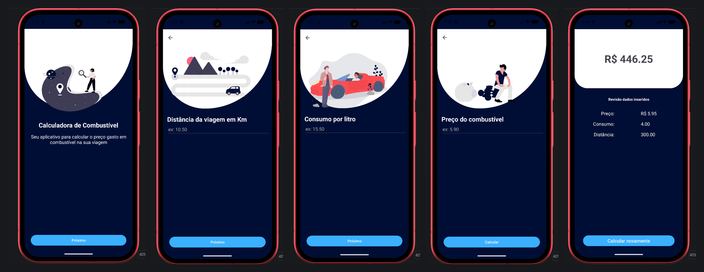

<h1 align="center"> FuelCalculator </h1>

Uma calculadora de combustível para Android, desenvolvida com Kotlin e XML.  

 

  

## 🚀 Tecnologias

Esse projeto foi desenvolvido com as seguintes tecnologias e ferramentas:

- Kotlin
- XML
- Android SDK
- Material Components
- Gradle
- Android Studio

## 💻 Projeto

O FuelCalculator é um aplicativo Android para calcular o gasto estimado com combustível em uma viagem. O usuário informa a distância a percorrer, o consumo do veículo em quilômetros por litro e o preço do litro do combustível. Ao final, o aplicativo apresenta um resumo dos dados e o custo total estimado, com a opção de iniciar um novo cálculo.

O projeto foi desenvolvido para praticar o desenvolvimento Android com Kotlin, a criação de interfaces com XML e a navegação entre telas.
